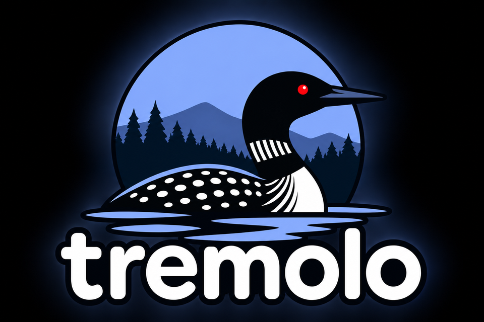

<p align="center"></p>

# tremolo

**Observability for small setups: push metrics and logs, get good-looking dashboards.** tremolo is a
server that accepts the formats your tools already speak (OpenTelemetry, Prometheus remote write, Loki),
stores them in VictoriaMetrics and VictoriaLogs, and serves a fast web UI for hosts, dashboards and log
search. There is no Grafana to set up.

Named after the loon's tremolo call: the one it makes when something is wrong.

```
 apps, CI runners  ── OTLP ──────────────┐
 Linux machines    ── OpenTelemetry ─────┤
 Prometheus/Alloy  ── remote write ──────┼──▶ tremolo ──▶ VictoriaMetrics + VictoriaLogs
 Promtail          ── Loki push ─────────┤        │
 Kubernetes        ── tremolo-kubernetes-collector       └──▶ web UI: hosts, dashboards, logs
```

## Why

- **One server, many senders.** Anything that speaks OTLP (HTTP or gRPC), Prometheus remote write or
  the Loki push API can send to tremolo. A CI runner, a Raspberry Pi and a Kubernetes cluster can all
  report to the same place.
- **Light:** VictoriaMetrics and VictoriaLogs are single binaries that need a fraction of the memory and
  disk of the usual stack.
- **Hosts first:** every machine that sends host metrics shows up with its CPU, memory, disks and logs,
  whether or not it is in a cluster. Machines that stop reporting are shown as unreachable.
- **Dashboards as code:** small YAML files. Add your own without touching the UI.
- **Knows about power management:** Kubernetes nodes that [possum](https://github.com/tpural/possum)
  suspends or switches off are shown as **asleep** or **off**, not as broken.
- **Standard underneath:** metrics speak PromQL (MetricsQL), logs speak LogsQL. Point Grafana or anything
  else at the same storage if you want to.

## Run it

### On one machine (Docker Compose)

```sh
git clone https://github.com/tpural/tremolo && cd tremolo/deploy/compose
docker compose up -d                                              # server and storage
HOST_NAME=$(hostname) docker compose --profile collector up -d    # also collect this machine
```

Open http://localhost:8080.

### On Kubernetes

```sh
helm install tremolo oci://ghcr.io/tpural/charts/tremolo -n tremolo --create-namespace
```

This installs the server, storage and **tremolo-kubernetes-collector**, which sends the cluster's
node and pod metrics, container logs, events and the `/metrics` of annotated pods to it. To report
another cluster to the same tremolo, install only the collector there:

```sh
helm install tremolo-collector oci://ghcr.io/tpural/charts/tremolo-kubernetes-collector \
  -n tremolo --create-namespace --set tremolo.url=http://tremolo.example.com:4318 --set tremolo.token=...
```

For a permanent UI address, enable the chart's Gateway API route (`httpRoute`).

## Sending data

| Protocol | Address | Path |
|---|---|---|
| OTLP/HTTP (protobuf or JSON) | `:4318` | `/v1/metrics`, `/v1/logs` |
| OTLP/gRPC | `:4317` | metrics and logs services |
| Prometheus remote write | `:4318` | `/api/v1/write` |
| Loki push | `:4318` | `/loki/api/v1/push` |

Traces are not stored yet; trace exports get `501`/`Unimplemented`.

**From an app** using an OpenTelemetry SDK:

```sh
OTEL_EXPORTER_OTLP_ENDPOINT=http://tremolo:4318
OTEL_EXPORTER_OTLP_HEADERS="Authorization=Bearer <token>"
OTEL_RESOURCE_ATTRIBUTES=host.name=$(hostname)
```

**From a Linux machine:** run the OpenTelemetry Collector (contrib) with
[`deploy/host/otelcol.yaml`](deploy/host/otelcol.yaml) and `TREMOLO_URL` / `TREMOLO_TOKEN` set.

**From a script or CI job:**

```sh
curl -X POST http://tremolo:4318/v1/logs -H "Authorization: Bearer $TOKEN" \
  -H 'Content-Type: application/json' -d '{"resourceLogs":[{"resource":{"attributes":[
    {"key":"service.name","value":{"stringValue":"nightly-build"}}]},
    "scopeLogs":[{"logRecords":[{"severityText":"ERROR","body":{"stringValue":"build failed"}}]}]}]}'
```

**From a Kubernetes pod:** annotate it and the collector scrapes its `/metrics`:

```yaml
metadata:
  annotations:
    prometheus.io/scrape: "true"
    prometheus.io/port: "9090"
    prometheus.io/path: /metrics   # optional
```

### Tokens

Without tokens, anyone who can reach ports 4317/4318 can write. Before exposing them, give each sender
a token:

```yaml
# tokens.yaml, passed with --ingest-tokens-file (chart: ingest.tokens or ingest.existingSecret)
ci: 6f1c…
laptop: 93ab…
```

Senders send `Authorization: Bearer <token>`. The token's name is added to everything it sends as a
`source` label (metrics) or field (logs), so you can tell senders apart.

### Kubernetes nodes and servers

tremolo shows each host as a **Kubernetes node** or a **server**, from how its metrics arrive:
tremolo-kubernetes-collector marks everything it sends with `tremolo.collector=kubernetes` and the
cluster's name (`clusterName` in its values), and the host collector config marks its machines with
`tremolo.collector=host`. Nodes are grouped by cluster, so several clusters can report to one tremolo.
Any other sender of host metrics shows up as a server.

## The UI

- **Hosts:** every machine with its state and CPU/memory, grouped into Kubernetes clusters and servers,
  plus charts across hosts. A quiet loon means nothing needs attention; a calling one lists what does.
- **Host pages:** CPU, memory, disks, network, filesystems and logs for one machine.
- **Dashboards:** built-in and your own, grouped in the sidebar.
- **Logs:** LogsQL search with namespace and level filters, field details, and live tail.

Every page has a time range (15m to 30d), refreshes on its own, and follows your light or dark theme.

## Dashboards

A dashboard is a YAML file of panels. Add your own through the chart:

```yaml
dashboards:
  my-app.yaml: |
    id: my-app
    title: My app
    group: Services
    panels:
      - title: Requests per second
        query: sum by (code) (rate(http_requests_total{namespace="my-app"}[5m]))
        legend: "{{code}}"
        width: 8
      - title: Error rate
        type: stat
        query: sum(rate(http_requests_total{code=~"5.."}[5m])) / sum(rate(http_requests_total[5m]))
        unit: percentunit
        warn: 0.01
        bad: 0.05
        width: 4
      - title: Errors
        type: logs
        query: 'k8s.namespace.name:"my-app" error'
        width: 12
```

| Panel key | Meaning |
|---|---|
| `type` | `timeseries` (default), `stat`, `table` or `logs` |
| `query` | MetricsQL/PromQL, or LogsQL for `logs` panels. Page variables such as `$host` are filled in. |
| `legend` | Series name template, e.g. `{{pod}}` |
| `unit` | `short`, `percent`, `percentunit`, `bytes`, `bytes/s`, `seconds`, `ms`, `celsius` |
| `width` | Columns out of 12 (default 6) |
| `stack` | Stack timeseries areas |
| `warn` / `bad` | Thresholds that color `stat` and `table` values |

A dashboard with the same `id` as a built-in replaces it.

## Configuration

**Server flags:**

| Flag | Default | Meaning |
|---|---|---|
| `--listen` | `:8080` | UI and API |
| `--ingest-listen` | `:4318` | OTLP/HTTP, remote write, Loki push (empty disables) |
| `--grpc-listen` | `:4317` | OTLP/gRPC (empty disables) |
| `--ingest-tokens-file` | | YAML map of sender name to token |
| `--metrics-url` / `--logs-url` | `localhost:8428` / `:9428` | VictoriaMetrics and VictoriaLogs |
| `--dashboards` | | Directory of extra dashboards |
| `--possum-url` | | possum's status URL, to list nodes it has switched off |

Kubernetes access is optional and picked up automatically (in-cluster or `KUBECONFIG`); with it, hosts
also show their Kubernetes state.

**Charts:** [tremolo](charts/tremolo/values.yaml) and
[tremolo-kubernetes-collector](charts/tremolo-kubernetes-collector/values.yaml) have documented values.
The storage and collector sections are passed to the upstream
[victoria-metrics-single](https://docs.victoriametrics.com/helm/victoria-metrics-single/),
[victoria-logs-single](https://docs.victoriametrics.com/helm/victoria-logs-single/) and
[opentelemetry-collector](https://github.com/open-telemetry/opentelemetry-helm-charts) charts.

## Development

```sh
make test     # Go and web tests
make lint     # golangci-lint and helm lint
make build    # builds the web app and embeds it in bin/tremolo

# Locally: docker compose up victoriametrics victorialogs (expose 8428/9428), then
make dev                    # API on :8080
cd web && npm run dev       # UI with hot reload on :5173
```

PR titles are conventional commits. Merging to `main` releases automatically. Comment `/rc` on a PR to
build a release-candidate image and chart.

## License

Apache 2.0
